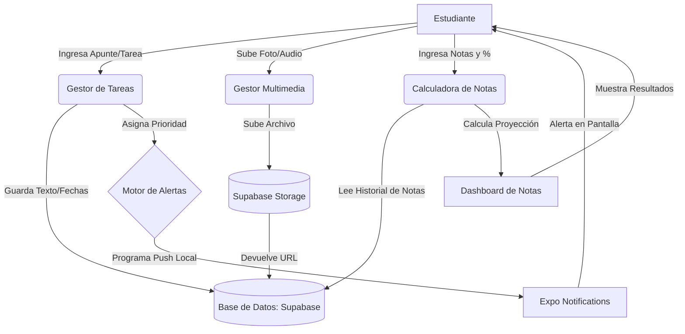

# 📱 Planificación de App: NotaSegura (MVP)

Un gestor académico diseñado para centralizar apuntes, organizar el tiempo mediante alertas inteligentes y proyectar calificaciones, solucionando la dispersión de información de los estudiantes.

---

## 🚀 1. Visión General y Contexto

**NotaSegura** nace de la necesidad de los estudiantes universitarios y de instituto de tener una "bitácora" en tiempo real. Resuelve el problema de no saber en qué parte del temario se quedó en la última clase, la pérdida de fechas límite por mala gestión de prioridades, y la incertidumbre matemática al final del semestre (el clásico "¿cuánto necesito sacar en el final para pasar?").

---

## 👤 2. Casos de Uso Principales (Actor: Estudiante)

### CU-01: Registro de Bitácora de Clase

* **Descripción:** El estudiante guarda el estado actual de una materia justo al terminar la clase.
* **Flujo principal:**
  1. El usuario selecciona la materia.
  2. Escribe un texto breve (ej. "Vimos derivadas, el profesor dejó un ejercicio pendiente").
  3. Opcionalmente, pulsa el botón de micrófono para grabar un audio corto o la cámara para tomar una foto del pizarrón.
  4. El sistema guarda el apunte y sube los archivos en segundo plano.

### CU-02: Gestión de Tareas con Prioridad y Alertas

* **Descripción:** El estudiante crea una tarea o asignación y el sistema le alerta automáticamente.
* **Flujo principal:**
  1. El usuario crea una tarea y asigna una fecha de entrega.
  2. El usuario selecciona el nivel de prioridad (Alta, Media, Baja).
  3. El sistema calcula las fechas óptimas de recordatorio según la prioridad (Ej. Alta = 7, 3 y 1 días antes).
  4. El sistema programa notificaciones locales automáticas en el dispositivo.

### CU-03: Simulación y Proyección de Notas

* **Descripción:** El estudiante calcula cuánto necesita para aprobar la materia.
* **Flujo principal:**
  1. El usuario entra a la calculadora de una materia (cuya nota mínima aprobatoria es 3.0, por ejemplo).
  2. Ingresa un corte evaluado: Nota obtenida (ej. 4.0) y peso porcentual (ej. 30%).
  3. El sistema procesa los datos y muestra un dashboard: "Llevas 1.2 acumulado. Faltan 70% por evaluar. Necesitas un promedio de 2.57 en el resto del semestre para pasar".

---

## 🔄 3. Diagrama de Flujo (Mermaid)

El siguiente diagrama ilustra cómo fluye la información a través de la arquitectura de la app:



---

## 💻 4. Tecnologías para el Desarrollo (Stack Técnico)

Para asegurar un desarrollo ágil y compatible con iOS y Android, utilizaremos el siguiente stack:

### Frontend (Aplicación Móvil)

* **Framework:** **React Native** (Permite usar JavaScript/TypeScript para compilar aplicaciones nativas).
* **Entorno y Herramientas:** **Expo** (Simplifica drásticamente el desarrollo, acceso rápido a APIs del dispositivo sin tocar código nativo de Android/iOS).
* **Navegación:** **React Navigation** (Para moverse fluidamente entre la vista de Tareas, Calculadora y Ajustes).
* **Gestión de Estado:** **Zustand** o **Context API** (Para mantener las materias cargadas en memoria sin hacer tantas peticiones a la base de datos).
* **Notificaciones:** `expo-notifications` (Para programar las alertas locales basadas en el calendario).
* **Multimedia:** `expo-camera` y `expo-av` (Para captura de fotos y grabación de audio).

### Backend y Base de Datos (BaaS)

* **Proveedor:** **Supabase** (Una alternativa Open Source a Firebase).
* **Base de Datos:** **PostgreSQL** (Relacional, perfecta para vincular Materias -> Tareas -> Archivos).
* **Almacenamiento (Storage):** Supabase Storage (Buckets para guardar los audios, videos y fotos de manera segura).
* **Autenticación:** Supabase Auth (Para permitir que el usuario se registre con Email o Google y no pierda sus datos si cambia de celular).

### Herramientas de Diseño y Planificación

* **Diseño UI/UX:** **Figma** (Para crear los wireframes y el prototipo visual antes de programar).
* **Control de Versiones:** **Git & GitHub** (Para manejar el código fuente).

---

## 🗄️ 5. Modelo de Datos Entidad-Relación (Simplificado)

| Tabla              | Campos Principales                                                       | Relaciones                      |
| ------------------ | ------------------------------------------------------------------------ | ------------------------------- |
| **Users**    | `id`, `email`, `created_at`                                        | Autenticación de Supabase.     |
| **Subjects** | `id`, `user_id`, `name`, `target_grade`                          | Vinculada a **Users**.    |
| **Tasks**    | `id`, `subject_id`, `title`, `notes`, `due_date`, `priority` | Vinculada a **Subjects**. |
| **Media**    | `id`, `task_id`, `file_url`, `type` (audio/img)                  | Vinculada a **Tasks**.    |
| **Grades**   | `id`, `subject_id`, `name`, `weight_%`, `grade`                | Vinculada a **Subjects**. |

# Actualización de Requerimientos: NotaSegura (Modificaciones)

Este documento detalla las modificaciones y nuevas características solicitadas para los módulos de la aplicación, mejorando la flexibilidad en la gestión de tareas y el cálculo de notas.

## 1. Módulo de Calculadora Académica: Edición de Notas y Porcentajes

**Descripción de la Mejora:**
Actualmente, los usuarios pueden ingresar notas con sus respectivos porcentajes. Se requiere añadir la capacidad de modificar una nota ya registrada (tanto el valor de la calificación como su peso porcentual) sin tener que eliminarla y crearla de nuevo.

**Especificaciones de Interfaz (UI/UX):**

* **Acción de Edición:** En la lista de notas de una materia, al tocar un ítem (o mediante un gesto de *swipe* hacia la derecha/izquierda), aparecerá un botón/ícono de "Editar" (lápiz).
* **Modal de Edición:** Al accionar el botón, se abrirá un modal o formulario pre-llenado con los datos actuales de la nota.
* **Campos Editables:**
  * Valor de la nota (ej. 4.5).
  * Porcentaje asignado (ej. 20%).
* **Validación:** El sistema debe re-calcular inmediatamente si el nuevo porcentaje sumado a las demás notas no supera el 100% permitido para la materia.
* **Acción:** Botón de "Guardar Cambios" que actualizará el estado global y re-calculará el promedio proyectado al instante.

**Impacto en Base de Datos (Supabase):**

* Se utilizará una operación `UPDATE` en la tabla de notas, buscando por el `id` de la nota y actualizando las columnas `grade_value` y `weight_percentage`.

---

## 2. Módulo de Tareas y Alertas: Selector de Fecha y Edición

**Descripción de la Mejora:**
Se modificará el flujo de creación de tareas para incluir una vista de calendario o agenda, permitiendo al usuario programar tareas para fechas futuras (en lugar de preestablecer la fecha actual por defecto). Además, se habilitará la edición completa de tareas ya creadas.

**Especificaciones de Interfaz (UI/UX):**

* **Selector de Fecha (DatePicker):**
  * En el formulario de "Nueva Tarea", el campo de fecha ya no será un texto estático ni oculto.
  * Se integrará un componente de Calendario nativo (como `@react-native-community/datetimepicker` o un calendario interactivo visual).
  * El usuario visualizará los días del mes y podrá seleccionar el día exacto de entrega/vencimiento.
* **Edición de Tareas Existentes:**
  * Al hacer clic en una tarea desde la lista principal o el panel de alertas, se abrirá una pantalla de "Detalle/Edición de Tarea".
  * **Campos Editables:** Título, Descripción, Fecha de vencimiento (usando el nuevo Calendario) y Nivel de Prioridad (Alta, Media, Baja).
* **Gestión de Alertas:** Si se modifica la fecha o la prioridad de una tarea, el sistema de alertas (Expo Notifications) debe cancelar la notificación programada anterior y re-programar una nueva basada en los nuevos datos.

**Impacto en Base de Datos (Supabase):**

* **Tareas:** Operación `UPDATE` en la tabla de tareas, permitiendo sobreescribir `title`, `description`, `due_date` y `priority`.

# Actualización NotaSegura: Vista Visual de Calendario para Tareas

## 1. Objetivo

Añadir una interfaz de calendario mensual interactiva en la sección de tareas. El usuario podrá visualizar rápidamente qué días tienen entregas pendientes mediante indicadores visuales e interactuar con el calendario para filtrar la lista de tareas por fecha.

## 2. Tecnologías Requeridas

* **Librería UI:** `react-native-calendars` (proporciona el componente `<Calendar />` con soporte para marcadores de eventos).
* **Backend:** Supabase (consultas filtradas por rango de fechas).
* **Estado:** Manejo de la fecha seleccionada (`selectedDate`) en el componente local o global.

## 3. Requerimientos de Interfaz de Usuario (UI/UX)

* **Toggle de Vistas:** Implementar un botón o segment control en la parte superior de `app/(tabs)/tasks.tsx` que permita al usuario alternar entre "Vista de Lista" (la actual) y "Vista de Calendario".
* **Renderizado del Calendario:**
  * Mostrar el mes actual por defecto.
  * Días con 1 o más tareas pendientes deben mostrar un punto indicador (`markedDates`).
  * Si es posible, usar el color principal de la aplicación (ej. Indigo `#4F46E5`) para el día actual y los marcadores.
* **Lista Filtrada:** Debajo del calendario, renderizar un `FlatList` que muestre exclusivamente las tareas cuya fecha de entrega coincida con el día tocado en el calendario. Si no hay tareas, mostrar un mensaje de "No hay tareas para esta fecha".

## 4. Requerimientos de Datos y Lógica (Supabase)

* **Columna Fecha:** Asegurar que la tabla `tasks` en Supabase incluye una columna `due_date` (tipo `date` o `timestamptz`).
* **Formateo de Datos:** El componente `<Calendar />` exige un objeto de fechas marcadas. Se debe crear una función que transforme el array de tareas de Supabase al formato requerido:
  ```javascript
  // Estructura requerida por react-native-calendars
  {
    '2026-11-02': { marked: true, dotColor: '#4F46E5' },
    '2026-11-15': { marked: true, dotColor: '#4F46E5' }
  }
  ```

## 5. Plan de Implementación Paso a Paso

1. **Instalación:** Ejecutar `npm install react-native-calendars` en la terminal.
2. **Componente:** Crear un archivo `components/TaskCalendar.tsx` que encapsule la lógica de la librería.
3. **Transformación:** Escribir un `useMemo` o `useEffect` que escuche los cambios en el array de tareas globales y regenere el objeto `markedDates`.
4. **Integración:** Importar `TaskCalendar` en la pantalla principal de tareas y conectarlo al estado del filtro de fecha de la lista inferior.

# Actualización de Requerimientos: Historial, Perfil y Bienvenida

Este documento detalla la implementación de la eliminación lógica de materias, la nueva gestión del perfil de usuario y la experiencia de inicio (onboarding) para la aplicación NotaSegura.

## 1. Eliminación Lógica y Restauración de Materias (Soft Delete)

**Descripción de la Mejora:**
En lugar de borrar permanentemente una materia (y perder sus notas/tareas), la materia se moverá a un "Historial" o "Papelera". El usuario podrá visualizar estas materias archivadas y tendrá la opción de restaurarlas en cualquier momento.

**Impacto en Base de Datos (Supabase):**

* **Tabla `subjects`:** Añadir una nueva columna booleana llamada `is_archived` (valor por defecto: `false`).
* **Consultas:** Modificar la consulta principal de la pestaña de materias para que solo traiga los registros donde `is_archived == false`.

**Especificaciones de Interfaz (UI/UX):**

* **Acción de Eliminar:** El botón actual de "Eliminar" ahora ejecutará un `UPDATE` cambiando `is_archived` a `true`. Mostrará una alerta: *"La materia fue enviada al historial"*.
* **Pantalla de Historial:** Crear una nueva vista (accesible desde un ícono en la parte superior o desde el Perfil) llamada "Historial de Materias".
* **Restauración:** En la lista del Historial, cada materia tendrá un botón "Restaurar" que cambiará `is_archived` a `false`, devolviéndola a la lista principal.

## 2. Pantalla de Bienvenida (Onboarding de Nombre)

**Descripción de la Mejora:**
Cuando el usuario instale y abra la aplicación (o inicie sesión) por primera vez, el sistema debe solicitarle un único dato obligatorio para personalizar su experiencia: su nombre.

**Especificaciones de Interfaz (UI/UX):**

* **Pantalla Modal/Inicial:** Una pantalla limpia con el logo de NotaSegura, un mensaje de bienvenida (ej. *"¡Bienvenido a NotaSegura! ¿Cómo te llamas?"*) y un único campo de texto.
* **Lógica de Navegación:** El sistema verificará si el campo `full_name` o `display_name` del usuario está vacío en la base de datos. Si está vacío, se muestra esta pantalla; si ya tiene nombre, pasa directamente a las pestañas (`/(tabs)`).

**Impacto en Base de Datos (Supabase):**

* Asegurar que la tabla `profiles` o `users` tenga la columna `full_name`. El botón "Continuar" hará un `UPDATE` en este campo.

## 3. Pestaña de Perfil de Usuario (Información Opcional)

**Descripción de la Mejora:**
Se agregará una nueva pestaña en la barra de navegación inferior (Tabs) dedicada a la información del usuario y ajustes generales.

**Especificaciones de Interfaz (UI/UX):**

* **Nueva Pestaña:** Agregar un nuevo tab llamado "Perfil" o "Mi Cuenta" en `app/(tabs)/profile.tsx`.
* **Formulario Opcional:** Mostrar el nombre (obligatorio, recogido en el Onboarding) y campos opcionales como:
  * Institución Educativa / Universidad.
  * Carrera o Grado.
  * Biografía o metas académicas.
* **Acciones:** Botón de "Guardar Cambios" y el botón de "Cerrar Sesión".
* **Enlace al Historial:** En esta pantalla se puede ubicar el botón que lleve a la p

# Correcciones y Mejoras: Guardado en Supabase y Saludo Dinámico

Este documento detalla las correcciones necesarias para asegurar que las operaciones de escritura en Supabase funcionen correctamente, así como la implementación de un saludo personalizado en la pantalla principal basado en la información del perfil del usuario.

## 1. Corrección: Fallo al guardar registros en Supabase

**Descripción del Problema:**
Las operaciones de inserción (`INSERT`) y actualización (`UPDATE`) no se están reflejando en la base de datos cuando se prueba desde Expo Go.

**Acciones Requeridas (Código y Configuración):**

* **Manejo de Errores (Frontend):**
  * Revisar todas las funciones de los servicios (ej. `src/services/supabase.ts`, o donde se hagan las mutaciones) y asegurar que los errores devueltos por Supabase se impriman en consola (ej. `if (error) console.error("Error Supabase:", error.message)`). Esto revelará si es un error de permisos o de red.
* **Validación de Variables de Entorno:**
  * Asegurar que el cliente de Supabase se inicialice estrictamente con `process.env.EXPO_PUBLIC_SUPABASE_URL` y `process.env.EXPO_PUBLIC_SUPABASE_ANON_KEY`.
* **Revisión de Políticas RLS (Instrucción para el desarrollador):**
  * Si el error en consola dice "new row violates row-level security policy", se debe ir al panel de Supabase > Authentication > Policies, y habilitar las políticas de `INSERT`, `UPDATE` y `SELECT` para usuarios autenticados en las tablas `profiles`, `subjects`, `tasks` y `grades`.

## 2. Mejora: Saludo Personalizado en Pantalla Principal

**Descripción de la Mejora:**
La pantalla de inicio (`app/(tabs)/index.tsx` o similar) debe mostrar un saludo dinámico que incluya el nombre del usuario configurado en la pestaña de Perfil (ej. "¡Hola, Juan!").

**Especificaciones de Interfaz y Lógica:**

* **Estado Global / Contexto:**

  * Si se está usando una tienda global (como Zustand, Redux o React Context) para la sesión, asegurar que el `full_name` del usuario esté disponible allí una vez que inicie sesión o lo actualice en su Perfil.
* **Consulta Directa (Alternativa):**

  * Si no hay estado global, crear un `useEffect` en la pantalla principal que haga un `SELECT full_name FROM profiles WHERE id = user.id` al montar el componente.
* **Renderizado (UI):**

  * En el encabezado de la pantalla principal, reemplazar el texto estático por: `¡Hola, {userName || 'Estudiante'}!`
  * Asegurar que el cambio sea reactivo: si el usuario va a la pestaña Perfil, cambia su nombre a "María", y vuelve a la pantalla principal, el texto debe actualizarse inmediatamente a "¡Hola, María!".antalla de "Historial de Materias" mencionada en el punto 1.

  # Actualización NotaSegura: Edición de Materias, Filtros y Seguridad de Perfil

## 1. Modificación de Materias Existentes

* **Objetivo:** Permitir al usuario editar el nombre de una materia previamente creada.
* **Interfaz de Usuario (UI):**
  * Añadir un botón de "Editar" (ícono de lápiz) junto al botón de eliminar/archivar en la lista de materias (`app/(tabs)/subjects.tsx`).
  * Al presionar, abrir un Modal o un input en línea prellenado con el nombre actual de la materia.
* **Lógica de Datos (Supabase):**
  * Ejecutar un `UPDATE` en la tabla `subjects` modificando la columna `name` donde el `id` coincida.
  * Refrescar el estado local inmediatamente para reflejar el cambio en la pantalla.

## 2. Filtro de Materias Archivadas en el Semáforo Académico

* **Objetivo:** Evitar que las materias enviadas a la papelera (historial) afecten o aparezcan en el cálculo del semáforo académico.
* **Lógica de Datos:**
  * En la consulta de Supabase que obtiene las materias para el semáforo o en el servicio `gradesCalculator.ts`, agregar un filtro explícito: `.eq('is_archived', false)`.
  * Asegurar que el cálculo de promedios globales y estados (rojo, amarillo, verde) ignore por completo los registros archivados.

## 3. Visualización de Correo y Restablecimiento de Contraseña en el Perfil

* **Objetivo:** Mostrar la información de vinculación de la cuenta y permitir cambios de credenciales de forma segura.
* **Interfaz de Usuario (UI) en Perfil:**

  * Obtener y renderizar el correo electrónico del usuario actual (extraído de `supabase.auth.getUser()`) debajo del nombre (ej. "juan@email.com").
  * Agregar un botón visible: "Cambiar Contraseña".
* **Lógica de Datos (Supabase Auth):**

  * Al presionar "Cambiar Contraseña", ejecutar la función `supabase.auth.resetPasswordForEmail(email)`.
  * Mostrar un `Alert` informando al usuario: "Se ha enviado un enlace a tu correo para restablecer la contraseña".

  # Actualización NotaSegura: Edición de Materias, Filtros, Seguridad de Perfil y Autenticación

## 1. Modificación de Materias Existentes

* **Objetivo:** Permitir al usuario editar el nombre de una materia previamente creada.
* **Interfaz de Usuario (UI):**
  * Añadir un botón de "Editar" (ícono de lápiz) junto al botón de eliminar/archivar en la lista de materias (`app/(tabs)/subjects.tsx`).
  * Al presionar, abrir un Modal prellenado con el nombre y código actual de la materia.
* **Lógica de Datos (Supabase):**
  * Ejecutar un `UPDATE` en la tabla `subjects` modificando las columnas `name` y `code` donde el `id` coincida.
  * Refrescar el estado local inmediatamente para reflejar el cambio en la pantalla.

## 2. Filtro de Materias Archivadas en el Semáforo Académico

* **Objetivo:** Evitar que las materias enviadas a la papelera (historial) afecten o aparezcan en el cálculo del semáforo académico.
* **Lógica de Datos:**
  * En la consulta y mapeo de materias en la pantalla principal (`app/(tabs)/index.tsx`), filtrar explícitamente `activeSubjects = subjects.filter(s => !s.is_archived)`.
  * Asegurar que el cálculo de promedios globales y estados (rojo, amarillo, verde) ignore por completo los registros archivados.

## 3. Visualización de Correo y Restablecimiento de Contraseña en el Perfil

* **Objetivo:** Mostrar la información de vinculación de la cuenta y permitir cambios de credenciales de forma segura.
* **Interfaz de Usuario (UI) en Perfil:**
  * Obtener y renderizar el correo electrónico del usuario actual (extraído de `supabase.auth.getUser()`) debajo del nombre.
  * Agregar un botón visible: "Cambiar Contraseña".
* **Lógica de Datos (Supabase Auth):**
  * Al presionar "Cambiar Contraseña", ejecutar la función `supabase.auth.resetPasswordForEmail(email)`.
  * Mostrar un `Alert` informando al usuario: "Se ha enviado un enlace a tu correo para restablecer la contraseña".

## 4. Implementación de Autenticación (Login & Sign Up) y Corrección de Upsert en Profiles

* **Objetivo:** Proveer un flujo completo de autenticación con Supabase Auth (Registro e Inicio de sesión) y resolver restricciones de esquemas en la base de datos (RLS y restricciones NOT NULL).
* **Pantallas de Autenticación (`app/login.tsx` y `app/signup.tsx`):**

  * Creación de formularios modernos para Registrarse (`supabase.auth.signUp`) e Iniciar Sesión (`supabase.auth.signInWithPassword`), permitiendo asociar sesiones reales y cumplir con las políticas RLS de Supabase.
  * Opciones para continuar en modo local si no se desea iniciar sesión.
* **Integración en Perfil (`app/(tabs)/profile.tsx`):**

  * Visualización del correo del usuario conectado.
  * Botones dinámicos para Iniciar Sesión, Registrarse o Cerrar Sesión.
* **Corrección en `useAppStore.ts` (Profiles Upsert):**

  * Inclusión del campo `email: session.user.email` en las operaciones de `.upsert()` para la tabla `profiles`, previniendo errores de violación de restricción `NOT NULL` en la base de datos al actualizar el perfil.

  # Actualización NotaSegura: Edición, Filtros, Seguridad y Autenticación Completa

Este documento detalla las modificaciones para hacer la aplicación más funcional, robusta y segura, cubriendo la edición de materias, el impacto global del archivo, y un flujo de autenticación completo (incluyendo modo local seguro).

## 1. Modificación de Materias Existentes

* **Objetivo:** Permitir al usuario editar el nombre (y código) de una materia previamente creada.
* **Interfaz de Usuario (UI) y Validaciones:**
  * Añadir un botón de "Editar" (ícono de lápiz) junto al botón de eliminar/archivar en la lista de materias (`app/(tabs)/subjects.tsx`).
  * Al presionar, abrir un Modal prellenado con el nombre y código actual de la materia.
  * **Validación:** Bloquear el botón de "Guardar" si el campo de nombre está vacío.
* **Lógica de Datos (Supabase):**
  * Ejecutar un `UPDATE` en la tabla `subjects` modificando las columnas `name` y `code` donde el `id` coincida.
  * Refrescar el estado local inmediatamente para reflejar el cambio en la pantalla.

## 2. Filtro de Materias Archivadas (Semáforo y Calendario)

* **Objetivo:** Evitar que las materias enviadas a la papelera (historial) afecten los cálculos o sigan mostrando tareas pendientes.
* **Lógica de Datos (Efecto Cascada):**
  * **Semáforo:** En la consulta y mapeo de materias en la pantalla principal (`app/(tabs)/index.tsx`), filtrar explícitamente `activeSubjects = subjects.filter(s => !s.is_archived)`. El cálculo de promedios debe ignorar los registros archivados.
  * **Calendario y Tareas:** Aplicar el filtro de exclusión de materias archivadas en las consultas de la tabla `tasks`. Las tareas que pertenezcan a una materia con `is_archived = true` **no deben** renderizarse en el `TaskCalendar` ni disparar notificaciones push.

## 3. Visualización de Correo y Restablecimiento de Contraseña (Deep Linking)

* **Objetivo:** Mostrar la información de vinculación y permitir cambios de credenciales de forma segura, regresando correctamente a la app.
* **Interfaz de Usuario (UI) en Perfil:**
  * Renderizar el correo electrónico del usuario (extraído de `supabase.auth.getUser()`) debajo del nombre.
  * Agregar un botón visible: "Cambiar Contraseña".
* **Lógica de Datos (Supabase Auth):**
  * Al presionar "Cambiar Contraseña", ejecutar `supabase.auth.resetPasswordForEmail(email, { redirectTo: 'notasegura://reset-password' })`. (Ajustar el esquema `notasegura://` al configurado en app.json).
  * Crear la ruta correspondiente en Expo Router (`app/reset-password.tsx`) para capturar la redirección y guardar la nueva clave.

## 4. Implementación de Autenticación, Perfil y Modo Local Seguro

* **Objetivo:** Proveer un flujo de autenticación robusto, prevenir errores RLS y fugas de memoria al cerrar sesión.
* **Pantallas de Autenticación (`app/login.tsx` y `app/signup.tsx`):**

  * Formularios para Registrarse (`supabase.auth.signUp`) e Iniciar Sesión (`supabase.auth.signInWithPassword`).
  * **Validaciones:** Mostrar alerta de error si la contraseña de registro tiene menos de 6 caracteres.
  * **Modo Local (Anónimo):** Si el usuario elige "Continuar sin cuenta", utilizar el "Inicio de Sesión Anónimo" (`supabase.auth.signInAnonymously()`). Esto genera un `user_id` temporal para cumplir con las políticas RLS y permite escalar la cuenta a permanente después.
* **Gestión de Estado (useAppStore.ts) y Seguridad:**

  * **Upsert de Perfiles:** Incluir el campo `email: session.user.email` en las operaciones `.upsert()` de la tabla `profiles` para prevenir errores de violación `NOT NULL`.
  * **Limpieza de Sesión:** Al ejecutar `supabase.auth.signOut()`, disparar una función `clearStore()` que vacíe los arrays de `subjects`, `tasks`, `grades` y `profile` de la memoria local, evitando que otro usuario vea datos cacheados en el mismo dispositivo.

  # Actualización NotaSegura: Edición, Filtros, Seguridad y Autenticación Completa

  Este documento detalla las modificaciones para hacer la aplicación más funcional, robusta y segura, cubriendo la edición de materias, el impacto global del archivo, y un flujo de autenticación completo (incluyendo modo local seguro).

  ## 1. Modificación de Materias Existentes

  * **Objetivo:** Permitir al usuario editar el nombre (y código) de una materia previamente creada.
  * **Interfaz de Usuario (UI) y Validaciones:**

    * Añadir un botón de "Editar" (ícono de lápiz) junto al botón de eliminar/archivar en la lista de materias (`app/(tabs)/subjects.tsx`).
    * Al presionar, abrir un Modal prellenado con el nombre y código actual de la materia.
    * **Validación:** Bloquear el botón de "Guardar" si el campo de nombre está vacío.
  * **Lógica de Datos (Supabase):**

    * Ejecutar un `UPDATE` en la tabla `subjects` modificando las columnas `name` y `code` donde el `id` coincida.
    * Refrescar el estado local inmediatamente para reflejar el cambio en la pantalla.

  ## 2. Filtro de Materias Archivadas (Semáforo y Calendario)

  * **Objetivo:** Evitar que las materias enviadas a la papelera (historial) afecten los cálculos o sigan mostrando tareas pendientes.
  * **Lógica de Datos (Efecto Cascada):**

    * **Semáforo:** En la consulta y mapeo de materias en la pantalla principal (`app/(tabs)/index.tsx`), filtrar explícitamente `activeSubjects = subjects.filter(s => !s.is_archived)`. El cálculo de promedios debe ignorar los registros archivados.
    * **Calendario y Tareas:** Aplicar el filtro de exclusión de materias archivadas en las consultas de la tabla `tasks`. Las tareas que pertenezcan a una materia con `is_archived = true` **no deben** renderizarse en el `TaskCalendar` ni disparar notificaciones push.

  ## 3. Cambio de Contraseña mediante Código (OTP) en la App

  * **Objetivo:** Permitir al usuario solicitar un cambio de contraseña y validarlo introduciendo un código numérico (OTP) directamente en la app, sin necesidad de enlaces externos.
  * **Interfaz de Usuario (UI):**

    * **En Perfil:** Mostrar el correo actual (`supabase.auth.getUser()`) y un botón "Solicitar Cambio de Contraseña". Al presionarlo, llevar al usuario a una nueva pantalla.
    * **Pantalla de Recuperación (`app/reset-password.tsx`):** Mostrar un formulario con dos campos: "Código de Verificación (6 dígitos)" y "Nueva Contraseña".
  * **Lógica de Datos (Supabase Auth - Flujo OTP):**

    * **Paso 1 (Enviar):** Al presionar el botón en el perfil, ejecutar `supabase.auth.resetPasswordForEmail(email)`. *(Nota para configuración: En el panel de Supabase > Authentication > Email Templates > Recovery, asegurarse de incluir `{{ .Token }}` en el texto del correo para que envíe el código).*
    * **Paso 2 (Verificar):** En la pantalla de recuperación, al enviar el formulario, ejecutar `supabase.auth.verifyOtp({ email, token: codigoIngresado, type: 'recovery' })`.
    * **Paso 3 (Actualizar):** Si el código es correcto (la promesa se resuelve exitosamente), ejecutar inmediatamente `supabase.auth.updateUser({ password: nuevaContrasena })` y mostrar alerta de éxito.

  ## 4. Implementación de Autenticación, Perfil y Modo Local Seguro

  * **Objetivo:** Proveer un flujo de autenticación robusto, prevenir errores RLS y fugas de memoria al cerrar sesión.
  * **Pantallas de Autenticación (`app/login.tsx` y `app/signup.tsx`):**

    * Formularios para Registrarse (`supabase.auth.signUp`) e Iniciar Sesión (`supabase.auth.signInWithPassword`).
    * **Validaciones:** Mostrar alerta de error si la contraseña de registro tiene menos de 6 caracteres.
    * **Modo Local (Anónimo):** Si el usuario elige "Continuar sin cuenta", utilizar el "Inicio de Sesión Anónimo" (`supabase.auth.signInAnonymously()`). Esto genera un `user_id` temporal para cumplir con las políticas RLS y permite escalar la cuenta a permanente después.
  * **Gestión de Estado (useAppStore.ts) y Seguridad:**

    * **Upsert de Perfiles:** Incluir el campo `email: session.user.email` en las operaciones `.upsert()` de la tabla `profiles` para prevenir errores de violación `NOT NULL`.
    * **Limpieza de Sesión:** Al ejecutar `supabase.auth.signOut()`, disparar una función `clearStore()` que vacíe los arrays de `subjects`, `tasks`, `grades` y `profile` de la memoria local, evitando que otro usuario vea datos cacheados en el mismo dispositivo.
